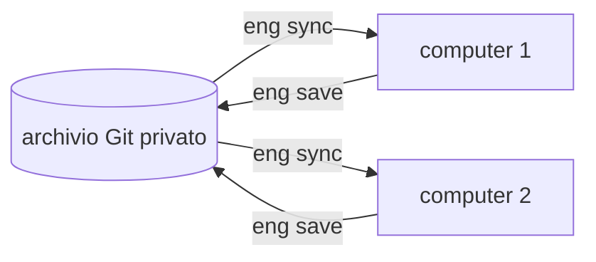

# Engramma

Engramma tiene le regole, gli appunti, la memoria e la configurazione degli agenti di sviluppo (Claude Code e Codex) in un **archivio Git privato**, e li collega ai tuoi progetti su ogni computer.



## Requisiti

Linux o WSL, Bash 5+, Python 3.10+, Git, OpenSSH e [mise](https://mise.jdx.dev), che installa i programmi di ogni progetto. Se mise manca, `eng setup` propone di installarlo.

## Installazione

```bash
git clone git@github.com:nikazzio/engramma-cli.git ~/engramma     # il programma
~/engramma/bin/sync.sh init                                       # archivio nuovo in ~/engramma-dati
~/engramma/bin/sync.sh setup git@github.com:ACCOUNT/ARCHIVIO-PRIVATO.git  # oppure: archivio esistente
~/engramma/bin/sync.sh setup -n                                   # mostra cosa cambierebbe
~/engramma/bin/sync.sh setup                                      # collega eng e la configurazione
```

> [!WARNING]
> `setup` cambia la configurazione del computer: `~/.claude/CLAUDE.md`, le impostazioni di Claude Code e di Codex, i plugin. Controlla l’anteprima con `setup -n`. Per un file locale diverso da quello da collegare, Engramma ti chiede quale copia conservare.

[Primi passi](docs/getting-started.md) spiega ogni passaggio, compreso il repository privato.

## Comandi essenziali

| Comando | Cosa fa |
|---|---|
| `eng` | Controlla il computer e i workspace, senza cambiare niente |
| `eng sync <ws>` | Scarica l'archivio, aggiorna i repo del workspace, salva e invia note e memoria |
| `eng save <ws>` | Salva e invia subito un workspace, senza toccare i repo |
| `eng sync global` / `eng save global` | Lo stesso per la configurazione del computer |
| `eng tools` | Programmi installati e mancanti; `eng tools install` li installa con mise |
| `eng integrations` | Integrazioni degli agenti attive (boost, caveman, code-review-graph, repomix) |

Elenco completo in [Comandi](docs/commands.md).

## Documentazione

[Indice](docs/README.md) · [Primi passi](docs/getting-started.md) · [Concetti](docs/concepts.md) · [Problemi comuni](docs/troubleshooting.md) · [Roadmap](docs/roadmap.md) · [Contribuire](CONTRIBUTING.md) · [Licenza MIT](LICENSE)
