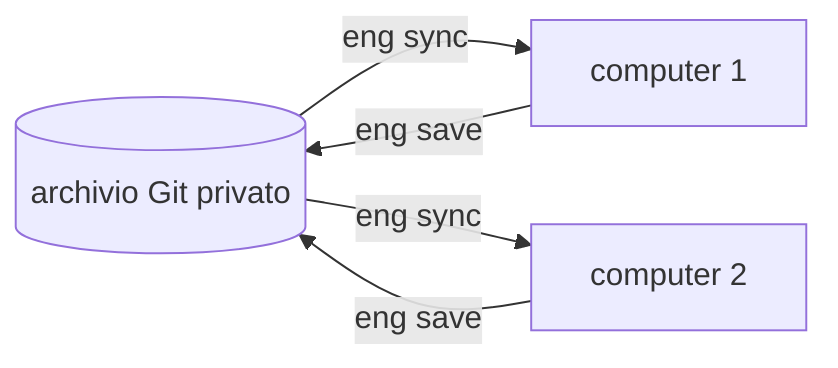

# Engramma

Engramma tiene regole, appunti, skill e configurazione per Claude Code, Codex e GitHub Copilot CLI in un **archivio Git privato**. Collega questi dati ai tuoi progetti su ogni computer e può sincronizzare la memoria locale di Claude Code.



## Requisiti

Linux o WSL, Bash 5+, Python 3.10+, Git, OpenSSH, `flock` (util-linux) e [mise](https://mise.jdx.dev), che installa i programmi di ogni progetto. Se mise manca, `eng setup` propone di installarlo.

## Installazione

```bash
git clone git@github.com:nikazzio/engramma-cli.git ~/engramma
~/engramma/bin/sync.sh setup --wizard
```

La guida ti fa scegliere l’archivio e gli agenti, mostra l’anteprima e chiede conferma. Per eseguire il setup in uno script usa `--non-interactive` e indica le scelte come opzioni.

[Primi passi](docs/getting-started.md) spiega ogni passaggio, compreso il repository privato.

## Comandi essenziali

| Comando | Cosa fa |
|---|---|
| `eng` | Controlla lo stato locale del computer e dei workspace |
| `eng sync <ws>` | Scarica l'archivio, aggiorna i repo del workspace, salva e invia note e memoria |
| `eng save <ws>` | Salva e invia subito un workspace, senza toccare i repo |
| `eng sync global` / `eng save global` | Lo stesso per la configurazione del computer |
| `eng tools` | Programmi installati e mancanti; `eng tools install` li installa con mise |
| `eng agents` | Agenti selezionati e stato della memoria |
| `eng integrations` | Integrazioni degli agenti attive (boost, caveman, code-review-graph, repomix) |

Elenco completo in [Comandi](docs/commands.md).

## Documentazione

[Guida online](https://nikazzio.github.io/engramma-cli/)

[Indice](docs/README.md) · [Primi passi](docs/getting-started.md) · [Concetti](docs/concepts.md) · [Problemi comuni](docs/troubleshooting.md) · [Roadmap](docs/roadmap.md) · [Contribuire](CONTRIBUTING.md) · [Licenza MIT](LICENSE)
