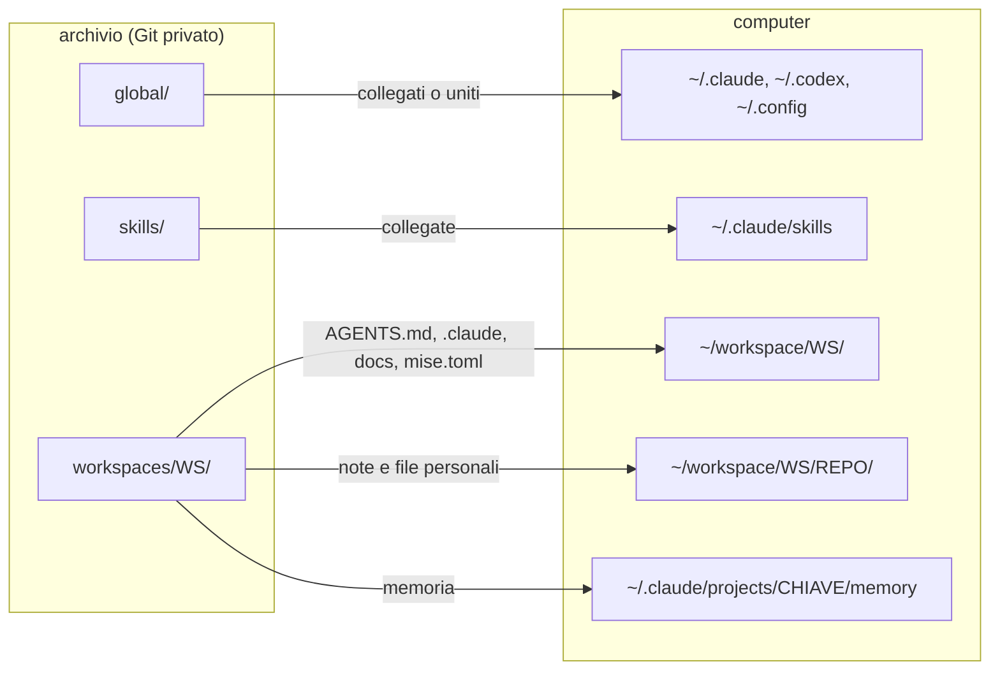
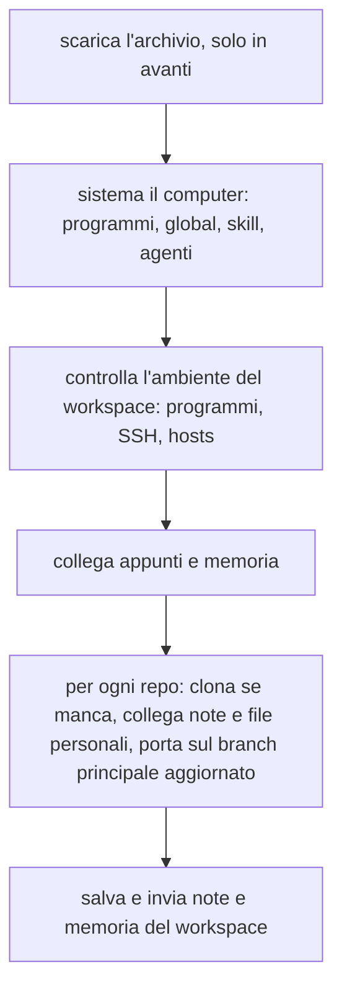

# Concetti

## Glossario

| Termine | Cos'è |
|---|---|
| **Programma** | Questo repo: il comando `eng` (anche `engramma`). Non contiene dati personali. |
| **Archivio** | Un repo Git privato con i tuoi dati: `workspaces/`, `global/`, `skills/`. Uno per persona, condiviso fra i tuoi computer. |
| **Workspace** | Un cliente o un progetto. Raggruppa uno o più repo, le regole per gli agenti, gli appunti e la memoria. Nell'archivio sta in `workspaces/<nome>/`; sul computer ha una cartella, per esempio `~/workspace/acme/`, dentro cui vengono clonati i suoi repo. |
| **Repo** | Un repository Git di un workspace, elencato in `repos.txt`. Il codice resta del team: engramma non lo modifica. |
| **Global** | La configurazione del computer che non appartiene a un workspace: regole generali, impostazioni di Claude Code e Codex, skill generali, programmi. Nei comandi si usa come un workspace di nome `global`. |
| **Collegamento** | Un symlink dal computer all'archivio. Modificare il file sul computer modifica l'archivio. |
| **File unito** | Un file che resta una copia sul computer e viene unito all'archivio voce per voce, in tutte e due le direzioni. Serve per i file che un programma riscrive per intero, come `~/.claude/settings.json`. |
| **Chiave della memoria** | Il nome della cartella in cui Claude Code tiene la memoria di un progetto: il percorso del progetto con ogni carattere non alfanumerico sostituito da `-`. |
| **Integrazione** | Uno strumento che cambia il lavoro degli agenti (boost, caveman, code-review-graph, repomix). È attivo solo se elencato in `global/integrations.txt`. |

## Dall'archivio al computer

Nei diagrammi `WS` è il nome del workspace e `REPO` quello di un repo.

Il dettaglio di ogni file è in [Formato dell'archivio](archive-format.md); cosa ne fanno gli agenti è in [Agenti](agents.md).

## Cosa fa `eng sync <ws>`

I repo vengono clonati e aggiornati in parallelo, 3 alla volta, mentre si controlla il computer. Un repo con modifiche non salvate o con un branch di lavoro in corso viene lasciato com'è.

## Regole di sicurezza

- **Archivio valido o niente.** Se l’archivio scelto manca o non è valido, Engramma lo segnala ed esegue soltanto i controlli della postazione che non richiedono l’archivio.
- **Controllo locale.** `eng` e `eng check` leggono lo stato locale e scrivono un log. `eng check --refresh` aggiorna anche i riferimenti remoti dell’archivio Git senza applicare modifiche ai suoi file.
- **Stessi dati, cartelle diverse.** Ogni computer può tenere un workspace in una cartella diversa (`--path`): l'archivio conserva solo i dati condivisi.
- **Mai sovrascrivere.** Dove dovrebbe esserci un collegamento e c'è altro, `eng` lo segnala e dice cosa confrontare. Sostituisce da solo solo una copia identica.
- **Backup prima di toccare.** Prima di sostituire una memoria scritta da Claude o un file globale diverso, `eng` ne tiene una copia in `~/.local/state/engramma/backup/`, fuori dall'archivio.
- **Solo in avanti.** L'archivio si aggiorna solo se non ci sono divergenze; altrimenti `eng` si ferma e lo dice.
- **Il codice del team resta del team.** I file personali dentro un repo sono esclusi dal suo Git con `.git/info/exclude`, che vale solo su quel computer.
