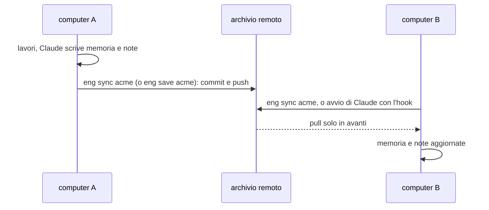

# Più computer

Le modifiche passano da un computer all'altro solo attraverso il remoto dell'archivio: commit e push da una parte, pull dall'altra.



## Salvare

| Cosa | Come |
|---|---|
| Note e memoria di un workspace | `eng sync <ws>` le salva da solo; `eng save <ws>` le salva subito, senza toccare i repo |
| Configurazione del computer e skill generali | `eng save global` |
| Altri file dell'archivio | commit e push a mano, con Git |

Se il push fallisce, rilancia lo stesso comando: riprova a inviare anche i commit già fatti.

## Ricevere

`eng sync` scarica l'archivio solo in avanti. Se l'archivio ha commit locali non inviati e insieme commit nuovi sul remoto, non unisce da solo. Lo segnala e suggerisce `git pull --rebase` e `git push` nell'archivio.

> [!TIP]
> Prima di cambiare computer lancia `eng`. Elenca, per ogni repo di ogni workspace, i file non salvati, i commit non inviati e i branch che esistono solo qui.

## Aggiornamento all'avvio di Claude Code

`eng session-start` scarica l'archivio, unisce i file uniti e, se l'archivio ha modifiche non salvate, lo dice a Claude in una riga. Va lanciato da un hook di Claude Code, che engramma non installa. Aggiungilo in `global/claude/settings.json`:

```json
{
  "hooks": {
    "SessionStart": [
      {
        "hooks": [
          { "type": "command", "command": "[ ! -x ~/.local/bin/engramma ] || ~/.local/bin/engramma session-start" }
        ]
      }
    ]
  }
}
```

Il controllo `[ ! -x ... ]` evita un errore sui computer dove engramma non è installato.

## File uniti

Claude Code riscrive `~/.claude/settings.json` per intero a ogni modifica: un collegamento si romperebbe. Con `unisci` in `links.txt` il file resta una copia sul computer e viene unito all'archivio in tutte e due le direzioni.

| La voce è cambiata | Risultato |
|---|---|
| solo sul computer (per esempio un plugin attivato con `/plugin`) | copiata nell'archivio |
| solo nell'archivio (arrivata dall'altro computer) | portata sul computer |
| da tutte e due le parti, in modo diverso | conflitto: resta com'è; in un terminale `eng setup` chiede quale valore tenere |
| tolta solo da una parte | tolta anche dall'altra |

- Gli oggetti JSON si uniscono chiave per chiave. Un array conta come un valore unico: se i due computer aggiungono ciascuno un permesso diverso a `permissions.allow`, nasce un conflitto.
- Un file del computer svuotato (`{}`) non svuota l'archivio: le voci dell'archivio tornano sul computer.
- `eng` ricorda cosa avevano in comune le due parti dopo l'ultima unione, in `~/.local/state/engramma/global/`.

## Conflitti e backup

| Situazione | Cosa fa `eng` |
|---|---|
| copia identica all'archivio al posto del collegamento | la sostituisce con il collegamento |
| memoria di Claude scritta prima del collegamento | la copia nell'archivio, verifica la copia, poi collega; tiene un backup |
| file globale diverso dall'archivio | in un terminale chiede quale tenere; altrimenti lo segnala |
| cartella con file diversi dall'archivio | non tocca niente e dice cosa confrontare |
| clone Git al posto di una cartella degli appunti | non tocca niente e dà il comando per spostarlo |
| `CLAUDE.local.md` con un contenuto suo | non tocca niente |

I backup stanno in `~/.local/state/engramma/backup/`, sul computer e fuori dall'archivio.
